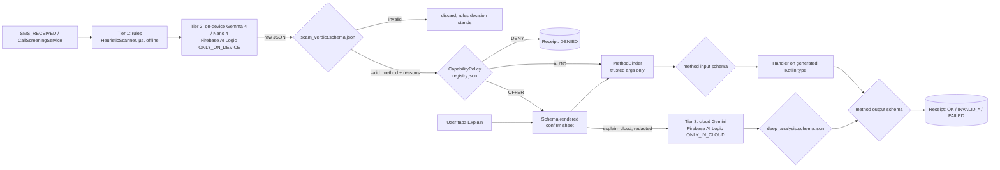

# Call Guardian

**A scam shield for your phone that reads your texts and calls on the device, and can only act through typed, schema-checked methods that leave a receipt.**

Call Guardian screens incoming SMS and calls. A private on-device model (Gemma 4 / Gemini Nano 4 through **Firebase AI Logic** hybrid inference) does the first read with no network, so it works in airplane mode. When you want a deeper explanation, a *redacted* copy goes to cloud Gemini, and only after you tap.

The model never touches your phone directly. It can only **propose one typed method** from a versioned registry, such as `guardian.call.block@v1` or `guardian.sms.quarantine@v1`. That proposal is validated against JSON Schema and a capability policy before anything runs, and every attempt writes a **receipt**. *The schema is the single source of truth for actions and their UI.* The same JSON Schema files generate the Kotlin types, validate model output, and render the confirmation sheets and receipt screens at runtime.

Personal project by Jeremy Hobson ([@repr0bated](https://github.com/repr0bated)). Licensed Apache-2.0. Built for #BuildHybridAI 2026 (Android track).

---

## Headline: typed methods, schemas and receipts

| Method id | Alias | Capability | Runs on | Auto-run? |
|---|---|---|---|---|
| `guardian.call.block@v1` | `block_number` | `telephony.block` | device | yes, if risk ≥ HIGH, confidence ≥ max(85, your threshold), not a contact |
| `guardian.call.allow@v1` | `allow_number` | `telephony.allow` | device | never (tap) |
| `guardian.call.reject@v1` | `reject_call` | `telephony.screen` | device | yes (calls only, risk ≥ HIGH) |
| `guardian.sms.quarantine@v1` | `quarantine_sms` | `sms.quarantine` | device | yes (SMS only, risk ≥ MEDIUM) |
| `guardian.report.scam@v1` | `report_scam` | `report.external` | device | never (opens 7726 composer) |
| `guardian.contact.save@v1` | `save_contact` | `contacts.write` | device | never (opens contact editor) |
| `guardian.cloud.explain@v1` | `explain_cloud` | `net.cloud_ai` | **cloud** | never (consent sheet shows the exact redacted text) |

How a proposal turns into a side effect:



* **Registry**: [`app/src/main/assets/schemas/registry.json`](app/src/main/assets/schemas/registry.json) (version `2026.11.1`), checked at load against `registry.schema.json`. Each method declares its capability, `execution: device|cloud`, channels, risk and confidence bounds, `contactSafe`, `autoApply`, `requiresConsent`, and paths to its input and output JSON Schemas under `schemas/methods/`.
* **Generated Kotlin types**: the `generateSchemaTypes` Gradle task (json-kotlin-schema-codegen) turns `registry.schema.json` and every `methods/*.json` into `@Serializable` classes in `com.example.callguardian.methods.gen` (`build/generated/source/schemas`). Handlers in [`MethodHandlers.kt`](app/src/main/java/com/example/callguardian/methods/MethodHandlers.kt) take and return only those generated types. None of them are hand-written.
* **The model proposes, it does not act**: the model emits `{riskLevel, category, confidence, reasons, method, advice}`. Arguments such as the phone number and event id are bound from trusted app state by [`MethodBinder`](app/src/main/java/com/example/callguardian/methods/MethodBinder.kt), never taken from model text. The bound input is still validated against the method's input schema.
* **Policy**: [`CapabilityPolicy`](app/src/main/java/com/example/callguardian/methods/CapabilityPolicy.kt) enforces the declared bounds:
  * it never blocks contacts or trusted senders;
  * it falls back from block to quarantine or reject when confidence is short;
  * cloud proposals are only ever *offered*, never run automatically;
  * cloud methods are denied when cloud is unavailable.
* **Receipts**: [`MethodDispatcher`](app/src/main/java/com/example/callguardian/methods/MethodDispatcher.kt) writes a Room row (`method_receipts`) for every attempt. Each row records the input JSON, registry version, input/output schema ids, where it ran, who proposed it, how it was dispatched (AUTO / USER_CONFIRMED / DENY), the status (OK / DENIED / INVALID_INPUT / INVALID_OUTPUT / FAILED), notes and duration. They appear on the **Receipts** tab.
* **Schema-driven UI**: [`schemaui/SchemaForm.kt`](app/src/main/java/com/example/callguardian/schemaui/SchemaForm.kt) maps any JSON Schema to fields: title, description, required markers, enums as chips, `readOnly` bound fields with a lock, `format: phone` with a phone keyboard, `format: epoch-millis` as a date, and lists. [`SchemaRenderer.kt`](app/src/main/java/com/example/callguardian/schemaui/SchemaRenderer.kt) renders the confirmation sheet with live validation, plus read-only receipt input and output views. To add a method you add a registry entry and two schema files, then a handler. Its confirmation and receipt screens come from the schema with no new UI code. `SchemaFormTest.everyRegistrySchemaRendersWithoutUnknownFields` enforces this.

## Where Firebase AI Logic is called

All model calls are in [`ai/HybridScamAnalyzer.kt`](app/src/main/java/com/example/callguardian/ai/HybridScamAnalyzer.kt):

* **Triage, on-device.** `Firebase.ai(backend = GenerativeBackend.googleAI()).generativeModel(..., onDeviceConfig = OnDeviceConfig(mode = ONLY_ON_DEVICE` (private mode) `| PREFER_ON_DEVICE, modelOption = PREVIEW_FAST | PREVIEW | STABLE, maxOutputTokens = 256, temperature = 0.1))`.
  * `PREVIEW_FAST` is Gemini Nano 4 Fast (Gemma 4 E2B). `PREVIEW` is Nano 4 Full (Gemma 4 E4B).
  * Called with `model.generateObject(ScamVerdict.firebaseAISchema(), prompt)`, using `@Generable` classes in `ai/AiSchemas.kt`.
  * `response.inferenceSource` records ON_DEVICE vs IN_CLOUD for every verdict.
* **Model lifecycle.** `onDeviceExtension.checkStatus() / download() / warmUp() / getModelName()` drive the Home screen's model card.
* **Deep analysis, cloud.** A second `generativeModel` with `OnDeviceConfig(mode = ONLY_IN_CLOUD)` and `generateObject(DeepAnalysis.firebaseAISchema(), redactedPrompt)`. It is only reachable through the `guardian.cloud.explain@v1` handler.
* **App Check.** [`firebase/FirebaseBootstrap.kt`](app/src/main/java/com/example/callguardian/firebase/FirebaseBootstrap.kt) installs the Play Integrity provider (`src/release`) or the debug provider (`src/debug`). The debug token appears in Settings → Cloud & App Check.

Gemma 4 runs **through Firebase AI Logic** (`OnDeviceModelOption.PREVIEW*`, which uses AICore). There is no MediaPipe or side-loaded weights.

## What was built during the submission period (Nov 2026)

The original repo was a lookup-only screening app that no longer built. On the `buildhybridai` branch:

* **Hybrid inference:** a three-tier pipeline (rules, then on-device Gemma 4 via Firebase AI Logic, then opt-in cloud Gemini) with redaction (`screening/Redactor.kt`), a private mode, and a foreground-only on-device queue. AICore refuses background inference, so events wait as PENDING and run when the app opens.
* **Typed methods:** the registry, capability policy, binder, dispatcher, Room receipts, Kotlin types generated from JSON Schema, and a schema-driven Compose renderer.
* **Rewritten app:** a new Compose UI (Home, Activity, event detail with a full pipeline trace, Receipts, Lab, Settings, Lists), a new manifest and permission model, and a new icon.
* **Fixes to the original app:**
  * **Build:** broken version catalog (duplicate `from()`, wrong `libs.libraries.*` refs), a non-existent AGP 8.14.0, a stale compose compiler config, and committed `app/build` and `.gradle` outputs (now untracked).
  * **SMS role:** the app demanded the default-SMS role without implementing a default SMS app, and called `abortBroadcast()` on a non-ordered broadcast. It now uses `SMS_RECEIVED` with `RECEIVE_SMS` only.
  * **Permissions:** removed SEND_SMS, WRITE_CONTACTS, MMS/WAP, ANSWER_PHONE_CALLS and READ_CALL_LOG.
  * **Calls:** removed the bogus `foregroundServiceType` on the screening service and the DIAL intent filter. Fixed the missing `android.telecom.Call` import (a compile error). Blocked calls no longer skip the call log.
  * **Lookups:** Moshi lacked `KotlinJsonAdapterFactory`, so lookups crashed at runtime. OkHttp logging leaked API keys from URLs.
  * **Misc:** the launcher icon used theme attrs and rendered wrong. Contact lookup needed an exact match and had no permission guard. XML Fragments were mixed into Compose. The Hugging Face scoring was replaced.
* **Tests and builds:** 38 JVM unit tests (schema renderer mapping, registry/enum consistency, binder output validates for every method and channel, capability policy, verdict validator, rules, redaction). The debug APK and an R8-minified, release-signed APK both build.

## Build

Requires JDK 21 and Android SDK 36.

```bash
./gradlew assembleDebug testDebugUnitTest        # works with or without google-services.json
```

* **Firebase config.** Put `google-services.json` at **`app/google-services.json`** (gitignored). The Google Services plugin is applied only when that file exists. Without it the app still builds and runs rules plus on-device AI, and cloud analysis shows as "not configured". You can also pass `-PFIREBASE_API_KEY= -PFIREBASE_APP_ID= -PFIREBASE_PROJECT_ID=` or the matching env vars.
* **Package names.** `io.github.repr0bated.callguardian` (release) and `io.github.repr0bated.callguardian.debug` (debug).
* **Release signing.** Set `CG_KEYSTORE`, `CG_KEYSTORE_PASSWORD`, `CG_KEY_ALIAS` and `CG_KEY_PASSWORD`, then run `./gradlew assembleRelease`. Keep the keystore outside the repo; `*.jks` is gitignored.
* **Cloud model.** Defaults to `gemini-3.5-flash-lite`. Override with `-PCLOUD_MODEL=`.

## Install on a Galaxy S25 Ultra (stock, locked bootloader)

1. **Update AICore and enroll in the AICore Developer Preview.** This is required for Gemma 4 / Nano 4 (`PREVIEW*` models).
   1. Update **AICore** and **Private Compute Services** from the Play Store.
   2. Enable **Developer options**: Settings → About phone → Software information → tap *Build number* 7×.
   3. Go to Settings → Developer options → **AICore Settings** → enable **AICore Developer Preview** → Accept.
   4. Open the AICore app (or this app's Home → *Download model*) and let the Nano 4 model download on Wi-Fi.
   5. AICore does not work with an unlocked bootloader. Jeremy's device is stock, so this is fine.
2. Install the APK: `adb install -r callguardian.apk`, or open the file on the phone.
3. **Android 15 restricted settings.** For a sideloaded app, the SMS permission may be greyed out. Go to Settings → Apps → Call Guardian → ⋮ → **Allow restricted settings**, then grant SMS.
4. In the app's Home screen, allow **call screening** (role), **SMS**, **contacts** and **notifications**.
5. For cloud analysis in a debug build, open Settings → Cloud & App Check and copy the **debug token**. Register it in the Firebase console under App Check → Manage debug tokens.

See [`docs/FIREBASE_SETUP.md`](docs/FIREBASE_SETUP.md) for the console steps, [`docs/DEMO_SCRIPT.md`](docs/DEMO_SCRIPT.md) for the 3-minute demo, and [`docs/DEVPOST.md`](docs/DEVPOST.md) for the submission text.

## Limits (honest list)

* On-device inference is foreground-only, English-first, capped at about 4k tokens of input, and subject to AICore per-app quotas. Calls are decided by rules within Telecom's 5-second budget, and the model reviews them afterwards.
* There is no call audio or transcript: calls are judged on metadata (hidden caller id, repeat calls, optional lookup).
* Play Integrity fails for sideloaded release APKs, so the demo uses the debug build with the debug App Check provider.

## License

Apache License 2.0, Copyright 2026 Jeremy Hobson. See [LICENSE](LICENSE).
